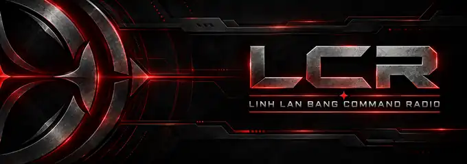

<p align="center">
  
</p>

<h1 align="center">LCR - LINH LAN BANG COMMAND RADIO</h1>

<p align="center"><b>COMMAND - CONNECT - COORDINATE</b></p>

<p align="center">
  <b>Tactical command-radio dành cho guild combat, raid nhiều tổ và bang chiến cường độ cao.</b><br>
  Giữ từng Unit ở đúng phòng của mình, nhưng vẫn nối toàn đội vào một tuyến chỉ huy thống nhất.
</p>

<p align="center">
  <b>LCR BƯỚC SANG KỶ NGUYÊN MỚI</b><br>
  <b>Ít thao tác hơn. Ít phần mềm hơn. Tập trung vào trận đánh.</b><br>
  LCR đang chuyển sang trải nghiệm trực tiếp trên Discord: khi server của đồng chí được cập nhật, không còn cần tải Helper, nhập Pair Code hay chạy ứng dụng bên ngoài.
</p>

<p align="center">
  <a href="https://github.com/Kjndst/LCR-Command-Radio/releases/tag/v0.0.8"><b>Helper 0.0.8 - Retirement Version</b></a><br>
  <sub>Bản lưu trữ kết thúc vòng đời Helper, không phải bản cài đặt hoặc bản cập nhật dành cho người chơi.</sub>
</p>

---

# I. COMMANDER - UNIT: MỘT MẠNG CHỈ HUY, KHÔNG PHẢI MỘT PHÒNG VOICE KHỔNG LỒ

<table>
<tr>
<td align="center" width="50%">
<br>
<b>COMMANDER</b><br>
Giữ nhịp trận đánh, phát lệnh xuống các Unit và nhận báo cáo từ những Leader cần lên sóng.
</td>
<td align="center" width="50%">
<br>
<b>UNIT</b><br>
Mỗi tổ tiếp tục nói chuyện trong channel riêng, giữ giao tiếp cục bộ gọn và không làm loãng toàn raid.
</td>
</tr>
</table>

LCR được xây dựng quanh một nguyên tắc rất đơn giản:

```text
                         COMMAND
                    Commander / Staff
                           |
             +-------------+-------------+
             |             |             |
           UNIT 1        UNIT 2        UNIT 3 ...
         Leader +        Leader +      Leader +
          Member          Member        Member
```

- **Commander -> Units:** phát lệnh xuống đội hình.
- **Unit Leader -> Command:** ưu tiên phát lên Command khi cần báo cáo.
- **Trong Unit:** vẫn nói Discord bình thường.
- **Unit -> Unit khác:** không tự relay chéo, tránh biến chiến trường thành một phòng voice hỗn loạn.

LCR không thay thế Discord. LCR bổ sung thứ Discord còn thiếu khi một guild bắt đầu chiến đấu theo đội hình: **tuyến chỉ huy xuyên nhiều voice channel.**

---

# II. LCR GIẢI QUYẾT VẤN ĐỀ GÌ?

Khi raid còn nhỏ, một voice channel là đủ. Khi đội hình lớn dần, cách đó bắt đầu vỡ.

Nếu gom tất cả vào một phòng, Commander phải tranh tiếng với mọi cuộc trao đổi cục bộ. Nếu chia thành nhiều phòng, từng Unit hoạt động sạch hơn nhưng tuyến chỉ huy lại bị cắt vụn: Commander phải nhảy channel, Leader khó báo cáo, và thông tin quan trọng có thể đến chậm đúng lúc trận đánh nóng nhất.

**LCR giữ cả hai ưu điểm:**

- Unit vẫn có không gian riêng để call mục tiêu, vị trí và chiến thuật cục bộ.
- Commander có thể đưa mệnh lệnh tới các Unit mà không phải chạy qua từng phòng.
- Unit Leader chỉ mở uplink khi thật sự cần báo cáo.
- Thành viên bình thường không phải học thêm quy trình hoặc cài thêm phần mềm.
- Khi mất quyền điều khiển hoặc trạng thái không còn chắc chắn, radio đóng lại thay vì tự mở sai tuyến.

Mục tiêu không phải cho nhiều người nói hơn.

Mục tiêu là để **đúng người được nghe, đúng lúc, đúng tuyến chỉ huy**.

---

# III. KHÁC GÌ DISCORD, SHOTCALLER BOT VÀ TEAMSPEAK?

| | Discord voice | Shotcaller bot | TeamSpeak / voice client khác | **LCR** |
|---|---|---|---|---|
| Giữ cộng đồng trên Discord | ✅ | ✅ | ❌ / phải chuyển client | ✅ |
| Unit ở phòng riêng | ✅ | ✅ | ✅ | ✅ |
| Commander phát xuống nhiều Unit | Không phải workflow mặc định | ✅ | Tùy cách tổ chức | ✅ |
| Unit Leader báo cáo có kiểm soát về Command | Không phải workflow mặc định | Thường không | Tùy cách tổ chức | ✅ |
| Không relay Unit-to-Unit ngoài ý muốn | Phụ thuộc cách dùng | Phụ thuộc bot | Phụ thuộc cấu hình | **Thiết kế mặc định** |
| Người chơi thường phải cài thêm client | Không | Không | Có | **Không** |

### So với Discord

Discord vẫn là nơi mọi người nói chuyện. LCR giúp nhiều channel có thể vận hành như một đội hình có chỉ huy, mà không bắt mọi người phải rời Discord.

### So với shotcaller bot

Một shotcaller bot thường giải quyết bài toán **một người phát xuống nhiều phòng**. LCR hướng tới một mạng command-radio hai chiều có kiểm soát: Commander có downlink, Unit Leader có uplink bằng PTT, còn các Unit vẫn được cô lập khỏi nhau.

**Shotcaller bot giống một hệ thống loa. LCR hướng tới một mạng vô tuyến chỉ huy.**

### So với TeamSpeak hoặc chuyển sang nền tảng voice khác

LCR không tuyên bố codec tốt hơn hay độ trễ thấp hơn mọi voice client trên thị trường. Điểm mạnh nằm ở workflow: guild **không phải rời Discord**, không phải dựng lại cộng đồng, role và channel, và member bình thường không phải cài client voice thứ hai.

Nếu cộng đồng đã vận hành hoàn hảo trên TeamSpeak thì không nhất thiết phải chuyển. LCR được sinh ra cho những guild **đã sống trên Discord nhưng muốn chỉ huy nhiều Unit tốt hơn Discord mặc định.**

---

# IV. KỶ NGUYÊN MỚI - CHỈ CẦN DISCORD

Discord biết đồng chí đang nói, nhưng không biết câu nói đó là **trao đổi trong Unit** hay **báo cáo lên Command**.

LCR giúp đội hình giữ hai cách liên lạc ấy rõ ràng, không làm lẫn tiếng nói của từng tổ với mệnh lệnh toàn raid.

Với trải nghiệm mới, mọi việc quan trọng đều diễn ra ngay trong Discord:

- **Thành viên Unit** vào phòng của mình và nói chuyện như bình thường.
- **Unit Leader** trao đổi trong Unit, chỉ ưu tiên báo cáo lên Command khi cần.
- **Commander** điều phối tuyến chỉ huy và đưa mệnh lệnh tới các Unit được chọn.
- **Không còn cần cài LCR Helper**, ghép Pair Code hay mở một cửa sổ khác chỉ để dùng radio.

Trải nghiệm này sẽ được áp dụng khi server Discord chuyển sang phiên bản LCR mới. **Cho đến khi có thông báo chuyển đổi, cách sử dụng hiện tại không thay đổi.**

Helper đã hoàn thành nhiệm vụ của mình. Phiên bản cuối **0.0.8 Retirement Version** được lưu giữ cùng [hai ảnh giao diện Pair / Main và những dấu mốc cuối cùng](https://github.com/Kjndst/LCR-Command-Radio/releases/tag/v0.0.8), để những gì từng làm nên LCR không biến mất cùng một lần nâng cấp.

---

# V. LCR ĐƯỢC XÂY QUANH TRẢI NGHIỆM TRẬN ĐÁNH

LCR bắt đầu từ nhu cầu rất thực tế của guild và tiếp tục được hoàn thiện từ chính những gì xảy ra trong server test và các phiên combat.

Kỷ nguyên mới không nhằm biến radio thành một hệ thống nhiều nút bấm hơn. Ngược lại, chúng tôi muốn người chơi có thể **vào đúng channel, nhận đúng lệnh, báo cáo đúng lúc** mà không phải nghĩ đến một phần mềm hỗ trợ đang chạy bên cạnh.

- **Ít chuẩn bị hơn:** không cần thêm ứng dụng riêng khi trải nghiệm mới được kích hoạt.
- **Liên lạc có kỷ luật hơn:** Unit giữ cuộc trò chuyện của Unit; tuyến chỉ huy chỉ mở khi cần.
- **Dễ theo dõi hơn:** mọi người biết mình đang nghe ai và lúc nào cần lên tiếng.
- **Tin cậy hơn:** khi radio không chắc quyền hoặc trạng thái, hệ thống ưu tiên không truyền sai tuyến.

Tất cả quay về một triết lý:

> **Simple by default. Durable by design.**

LCR phải nhẹ khi không có gì xảy ra, phản hồi nhanh khi trận đánh bắt đầu, và đủ đáng tin cậy để giữ tuyến liên lạc trong những thời điểm combat, raid và bang chiến căng thẳng nhất.

---

# VI. BẮT ĐẦU VỚI LCR

> Hướng dẫn dưới đây dành cho **trải nghiệm LCR mới sau khi server đã chuyển đổi**. Trước thông báo chuyển đổi chính thức, đồng chí tiếp tục sử dụng cách hiện tại.

### Thành viên Unit

Không cần cài gì.

1. Vào đúng Unit voice channel.
2. Nói chuyện bằng Discord như bình thường.
3. Nghe lệnh Commander qua Speaker của Unit.

### Unit Leader

1. Vào đúng Unit voice channel.
2. Nói chuyện với đồng đội trong Unit như bình thường.
3. Khi cần báo cáo lên Command, **giữ Priority theo quyền đã được cấu hình trong Discord** rồi nói.
4. Kết thúc báo cáo thì thả Priority, tiếp tục trao đổi trong Unit.

### Commander

1. Dùng `/setup` để chọn vai trò và các Command / Unit channel cần sử dụng.
2. Dùng `/start` để bắt đầu phiên radio đã cấu hình.
3. Điều phối các Unit từ Command Channel và kiểm tra trạng thái bằng `/status`.
4. Dùng `/stop` khi kết thúc phiên.

**Không có bước tải Helper hay Pair Code trong trải nghiệm mới.**

---

# VII. NGUYÊN TẮC VẬN HÀNH

```text
COMMANDER -> UNITS          : CÓ, theo phiên radio đang hoạt động
UNIT LEADER -> COMMAND      : CÓ, khi dùng Priority hợp lệ
UNIT -> UNIT KHÁC           : KHÔNG
TRÒ CHUYỆN TRONG UNIT       : VẪN DÙNG DISCORD BÌNH THƯỜNG
```

LCR ưu tiên **fail closed**. Nếu quyền điều khiển hoặc trạng thái tuyến không còn đủ chắc chắn, radio sẽ không tự mở một đường truyền mơ hồ.

---

# VIII. VISION

LCR không được xây để trở thành "thêm một bot Discord".

Chúng tôi muốn nó trở thành **hạ tầng command-radio dành cho guild combat**: đủ nhẹ để chạy thường trực, đủ đơn giản để người chơi gần như quên rằng nó đang tồn tại, nhưng đủ kỷ luật để cả đội hình dựa vào nó khi trận đánh bước vào giai đoạn quyết định.

**Clear authority. Controlled routes. Distributed units.**

**Command - Connect - Coordinate.**

Chào các đồng chí đến với LCR.

**Chào thân ái và quyết thắng!**

---

<p align="center">
  <b>LCR đang bước sang kỷ nguyên trực tiếp trên Discord.</b><br>
  <sub>Ngày chuyển đổi và cách sử dụng chính thức sẽ được thông báo riêng.</sub><br>
  <a href="https://github.com/Kjndst/LCR-Command-Radio/releases/tag/v0.0.8">LCR Helper 0.0.8 - Retirement Version</a>
</p>
