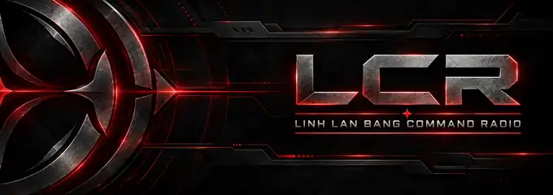

<p align="center">
  
</p>

<h1 align="center">LCR - LINH LAN BANG COMMAND RADIO</h1>

<p align="center"><b>COMMAND - CONNECT - COORDINATE</b></p>

<p align="center">
  <b>Tactical command-radio dành cho guild combat, raid nhiều tổ và bang chiến cường độ cao.</b><br>
  Giữ từng Unit ở đúng phòng của mình, nhưng vẫn nối toàn đội vào một tuyến chỉ huy thống nhất.
</p>

<p align="center">
  <a href="https://github.com/Kjndst/LCR-Command-Radio/releases/tag/v0.0.7-beta"><b>Download LCR 0.0.7 Beta</b></a>
</p>

---

# I. COMMANDER - UNIT: MỘT MẠNG CHỈ HUY, KHÔNG PHẢI MỘT PHÒNG VOICE KHỔNG LỒ

<table>
<tr>
<td align="center" width="50%">
<br>
<b>COMMANDER</b><br>
Giữ nhịp trận đánh, phát lệnh xuống các Unit và nhận báo cáo từ những Leader cần lên sóng.
</td>
<td align="center" width="50%">
<br>
<b>UNIT</b><br>
Mỗi tổ tiếp tục nói chuyện trong channel riêng, giữ giao tiếp cục bộ gọn và không làm loãng toàn raid.
</td>
</tr>
</table>

LCR được xây dựng quanh một nguyên tắc rất đơn giản:

```text
                         COMMAND
                    Commander / Staff
                           |
             +-------------+-------------+
             |             |             |
           UNIT 1        UNIT 2        UNIT 3 ...
         Leader +        Leader +      Leader +
          Member          Member        Member
```

- **Commander -> Units:** phát lệnh xuống đội hình.
- **Unit Leader -> Command:** giữ Radio Key khi cần báo cáo.
- **Trong Unit:** vẫn nói Discord bình thường.
- **Unit -> Unit khác:** không tự relay chéo, tránh biến chiến trường thành một phòng voice hỗn loạn.

LCR không thay thế Discord. LCR bổ sung thứ Discord còn thiếu khi một guild bắt đầu chiến đấu theo đội hình: **tuyến chỉ huy xuyên nhiều voice channel.**

---

# II. LCR GIẢI QUYẾT VẤN ĐỀ GÌ?

Khi raid còn nhỏ, một voice channel là đủ. Khi đội hình lớn dần, cách đó bắt đầu vỡ.

Nếu gom tất cả vào một phòng, Commander phải tranh tiếng với mọi cuộc trao đổi cục bộ. Nếu chia thành nhiều phòng, từng Unit hoạt động sạch hơn nhưng tuyến chỉ huy lại bị cắt vụn: Commander phải nhảy channel, Leader khó báo cáo, và thông tin quan trọng có thể đến chậm đúng lúc trận đánh nóng nhất.

**LCR giữ cả hai ưu điểm:**

- Unit vẫn có không gian riêng để call mục tiêu, vị trí và chiến thuật cục bộ.
- Commander có thể đưa mệnh lệnh tới các Unit mà không phải chạy qua từng phòng.
- Unit Leader chỉ mở uplink khi thật sự cần báo cáo.
- Thành viên bình thường không phải học thêm quy trình hoặc cài thêm phần mềm.
- Khi mất quyền điều khiển hoặc trạng thái không còn chắc chắn, radio đóng lại thay vì tự mở sai tuyến.

Mục tiêu không phải cho nhiều người nói hơn.

Mục tiêu là để **đúng người được nghe, đúng lúc, đúng tuyến chỉ huy**.

---

# III. KHÁC GÌ DISCORD, SHOTCALLER BOT VÀ TEAMSPEAK?

| | Discord voice | Shotcaller bot | TeamSpeak / voice client khác | **LCR** |
|---|---|---|---|---|
| Giữ cộng đồng trên Discord | ✅ | ✅ | ❌ / phải chuyển client | ✅ |
| Unit ở phòng riêng | ✅ | ✅ | ✅ | ✅ |
| Commander phát xuống nhiều Unit | Không phải workflow mặc định | ✅ | Tùy cách tổ chức | ✅ |
| Unit Leader báo cáo có kiểm soát về Command | Không phải workflow mặc định | Thường không | Tùy cách tổ chức | ✅ |
| Không relay Unit-to-Unit ngoài ý muốn | Phụ thuộc cách dùng | Phụ thuộc bot | Phụ thuộc cấu hình | **Thiết kế mặc định** |
| Người chơi thường phải cài thêm client | Không | Không | Có | **Không** |

### So với Discord

Discord vẫn là nơi mọi người nói chuyện. LCR chỉ thêm **radio layer** để nhiều channel có thể vận hành như một đội hình có chỉ huy.

### So với shotcaller bot

Một shotcaller bot thường giải quyết bài toán **một người phát xuống nhiều phòng**. LCR hướng tới một mạng command-radio hai chiều có kiểm soát: Commander có downlink, Unit Leader có uplink bằng PTT, còn các Unit vẫn được cô lập khỏi nhau.

**Shotcaller bot giống một hệ thống loa. LCR hướng tới một mạng vô tuyến chỉ huy.**

### So với TeamSpeak hoặc chuyển sang nền tảng voice khác

LCR không tuyên bố codec tốt hơn hay độ trễ thấp hơn mọi voice client trên thị trường. Điểm mạnh nằm ở workflow: guild **không phải rời Discord**, không phải dựng lại cộng đồng, role và channel, và member bình thường không phải cài client voice thứ hai.

Nếu cộng đồng đã vận hành hoàn hảo trên TeamSpeak thì không nhất thiết phải chuyển. LCR được sinh ra cho những guild **đã sống trên Discord nhưng muốn chỉ huy nhiều Unit tốt hơn Discord mặc định.**

---

# IV. LCR HELPER - BIẾN MỘT PHÍM THÀNH RADIO KEY

<p align="center">
  
</p>

Discord biết đồng chí đang nói, nhưng không biết câu nói đó là **trao đổi trong Unit** hay **báo cáo lên Command**.

Đó là lý do Helper tồn tại.

`LCR.exe` biến một phím quen thuộc như Mouse4/Mouse5 thành **Radio Key**:

```text
Nói bình thường
    -> chỉ Unit của đồng chí nghe

Giữ Radio Key + nói
    -> Unit vẫn nghe
    -> Command nhận báo cáo

Nhả Radio Key
    -> uplink đóng ngay
```

Helper được cố ý giữ nhỏ và đơn giản:

- không đăng nhập Discord thay người dùng;
- không dùng user token hoặc self-bot;
- không lấy microphone audio;
- không thay Discord client;
- chỉ điều khiển khi nào cổng radio được phép mở.

Với 0.0.7, Helper có giao diện mới theo phong cách **command-radio quân sự hiện đại**, tập trung vào khả năng đọc trạng thái trong một cái liếc mắt. PTT phản hồi rõ hơn, hoạt động ổn định hơn với game/app chạy quyền Administrator, Pair nhanh hơn và toàn bộ flow được tinh gọn để không trở thành thứ người chơi phải nghĩ đến giữa combat.

---

# V. CÔNG NGHỆ MỚI - ĐƯỢC XÂY CHO LCR, KHÔNG PHẢI ÉP LCR VỪA MỘT BOT VOICE CHUNG

LCR bắt đầu từ nhu cầu rất thực tế của guild và tiếp tục được tối ưu từ chính những gì xảy ra trong server test và các phiên combat.

Phiên bản hiện tại đã chuyển phần truyền thoại từ **Songbird** sang **LVT**, công nghệ voice do chúng tôi tự phát triển riêng cho mô hình Command - Unit của LCR.

Mục tiêu của LVT không phải thêm nhiều tính năng hơn. Ngược lại, nó cắt bỏ những gì LCR không cần:

- đường truyền thoại ngắn và dễ kiểm soát hơn;
- hạn chế xử lý lại âm thanh không cần thiết;
- giảm tài nguyên và các hàng đợi thừa;
- recovery rõ ràng hơn khi Discord hoặc mạng có vấn đề;
- tối ưu đúng cho một command-radio chạy lâu dài, thay vì một bot phát nhạc hay voice utility đa dụng.

Helper cũng đã rời kiến trúc tunnel cũ sang đường điều khiển trực tiếp hơn, ưu tiên thời gian từ **nhấn PTT -> radio nhận lệnh**.

Tất cả quay về một triết lý:

> **Simple by default. Durable by design.**

LCR phải nhẹ khi không có gì xảy ra, phản hồi nhanh khi trận đánh bắt đầu, và đủ đáng tin cậy để giữ tuyến liên lạc trong những thời điểm combat, raid và bang chiến căng thẳng nhất.

---

# VI. BẮT ĐẦU TRONG 30 GIÂY

### Thành viên Unit

Không cần cài gì.

1. Vào đúng Unit voice channel.
2. Nói chuyện bằng Discord như bình thường.
3. Nghe lệnh Commander qua Speaker của Unit.

### Unit Leader

1. Tải và mở **LCR Helper**.
2. Dùng `/radio-pair` trong Discord.
3. Nhập Pair Code vào Helper.
4. Chọn Radio Key.
5. Khi Helper báo **STANDBY**, radio đã sẵn sàng.

### Commander

Ở Command Channel, Commander điều phối các Unit theo mode radio đang được cấu hình. Trong Command Radio thông thường, Commander nói ở Command và lệnh được đưa xuống các Unit đang active.

---

# VII. NGUYÊN TẮC VẬN HÀNH

```text
COMMANDER -> UNITS          : CÓ
UNIT LEADER -> COMMAND      : CÓ, khi giữ Radio Key
UNIT -> UNIT KHÁC           : KHÔNG
HELPER -> MICROPHONE AUDIO  : KHÔNG
```

LCR ưu tiên **fail closed**. Nếu quyền điều khiển, pairing hoặc trạng thái tuyến không còn đủ chắc chắn, radio sẽ không tự mở một đường truyền mơ hồ.

---

# VIII. VISION

LCR không được xây để trở thành "thêm một bot Discord".

Chúng tôi muốn nó trở thành **hạ tầng command-radio dành cho guild combat**: đủ nhẹ để chạy thường trực, đủ đơn giản để người chơi gần như quên rằng nó đang tồn tại, nhưng đủ kỷ luật để cả đội hình dựa vào nó khi trận đánh bước vào giai đoạn quyết định.

**Clear authority. Controlled routes. Distributed units.**

**Command - Connect - Coordinate.**

Chào các đồng chí đến với LCR.

**Chào thân ái và quyết thắng!**

---

<p align="center">
  <b>Current public beta: v0.0.7-beta</b><br>
  <a href="https://github.com/Kjndst/LCR-Command-Radio/releases/tag/v0.0.7-beta">Download release</a>
</p>
