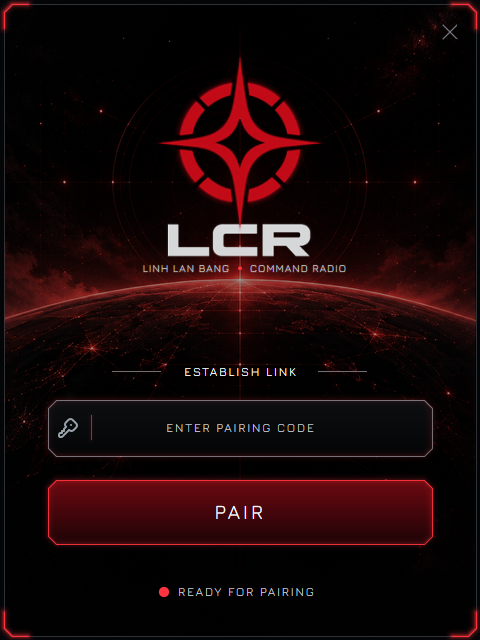
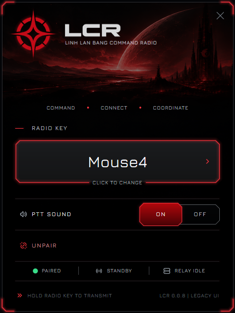

# LCR 0.0.8 - Helper Retirement Version

Chào các đồng chí,

Sau nhiều phiên bản đồng hành cùng những trận combat và bang chiến của Linh Lan Bang, **LCR Helper chính thức bước vào phiên bản cuối cùng: 0.0.8 Retirement Version**.

Từ những ngày đầu cần Pair, giữ Radio Key rồi chờ tín hiệu từ server, Helper đã giúp LCR từng bước trở thành một hệ thống command-radio thực sự. Nhưng mục tiêu của chúng ta chưa bao giờ là duy trì thêm một phần mềm Windows mãi mãi.

**Ít phần mềm hơn. Ít khâu kết nối hơn. Ít thứ có thể hỏng hơn.**

Đó là lý do LCR đang chuyển sang kiến trúc **Native-only**, để người dùng có thể sử dụng hệ thống trực tiếp trong Discord mà không cần cài thêm Helper sau khi bản Native chính thức được triển khai.

## 📡 Helper kết thúc nhiệm vụ

**0.0.8 không phải một bản nâng cấp PTT mới.** Đây là bản cuối cùng được chuẩn bị để lưu giữ Helper trước khi LCR chuyển hẳn sang thời kỳ mới.

Những gì được bảo tồn gồm mã nguồn, tài nguyên giao diện cuối cùng, các thành phần kỹ thuật lịch sử và tài liệu bản quyền. Helper và các chế độ Legacy không phải một phần của LCR Native-only.

Khi G5 được triển khai và xác minh, người dùng sẽ điều khiển LCR trong Discord. Không cần tải Helper 0.0.8 về để tiếp tục sử dụng radio.

## 🎛️ Giao diện cuối cùng

Giao diện được giữ theo bản **0.0.7 Beta Golden** đã thông qua ngày 14/10/2026. Chỉ tên phiên bản và nhãn Retirement/Legacy UI được thay đổi.

Hai hình dưới đây là ảnh render bằng mã Win32 thật của chính giao diện cuối cùng, không phải bản vẽ lại:

**Pair**

**Main / Radio Key**

*Lưu ý: ảnh Main sử dụng trạng thái Paired mô phỏng trong phép thử giao diện. Đây là bằng chứng lưu trữ thiết kế, không phải ảnh của một phiên Pair thực tế.*

## 🧪 Đã kiểm chứng những gì?

- Mã dựng giao diện khớp bản Golden cuối đã thông qua; toàn bộ 65 tài nguyên giao diện lịch sử được đối chiếu.
- Cả màn Pair và Main được render và chụp trên Windows bằng bộ kiểm thử Win32 cô lập.
- Hai executable lưu trữ mang phiên bản 0.0.8; nguồn, giấy phép và checksum được lưu giữ riêng.
- Bản lưu trữ không được sử dụng để xác nhận Helper kết nối/PTT hoặc vận hành trên server hiện tại.

## 📦 Bản lưu trữ và tải về

Hai ảnh **Pair** và **Main** là thành phần bắt buộc đi kèm bản phát hành này, ngoài hồ sơ nguồn gốc, release notes và bản lưu trữ được phê duyệt.

Bản executable cũ được lưu trong gói bảo tồn riêng, **không phải ứng dụng cần cài đặt**. Không phát hành executable unsigned như một bản cập nhật tự động cho người dùng.

## 🛡️ Hướng đi của LCR

**Simple by default. Durable by design.**

Helper đã hoàn thành nhiệm vụ của mình. Những gì tốt nhất của nó được giữ lại trong lịch sử; những phần không còn cần thiết sẽ được loại bỏ khỏi hệ thống đang vận hành.

LCR tiếp tục hành trình trở thành một command-radio nhẹ, nhanh, dễ đoán và bền bỉ hơn.

**Chào thân ái và quyết thắng!**
